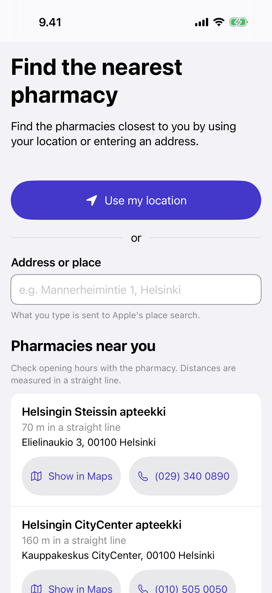
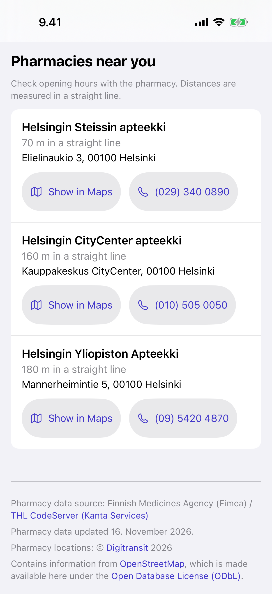

# Nearest pharmacy (iOS)

Finds the pharmacies nearest to you, or to a place you search for, in Finland. The app is in Finnish and English and follows the device language. It's the iOS version of the [web app](https://github.com/anttimo/pharmacy-finder-web).

  
  

The pharmacy list is the web app's, built from Fimea's pharmacy register and geocoded with Digitransit ([ADR 0001](docs/adr/0001-pharmacy-data-source.md)). The app ships a copy of it ([ADR 0101](docs/adr/0101-pharmacy-list-loading.md)), so the list may be incomplete or out of date: check opening hours with the pharmacy.

**Status:** a complete demo. "Use my location" and place search both show the three nearest pharmacies. The nearest search runs on the device, so your location never leaves it. Place search uses Apple's MapKit ([ADR 0003](docs/adr/0003-geocoding.md)) and needs no API key. The app isn't on the App Store.

**Next step:** the bundled list is only as fresh as the app's last release. The next thing to build would be live loading: the web app rebuilds the list every day, and the app downloads it, caches it and falls back to its bundled copy ([ADR 0101](docs/adr/0101-pharmacy-list-loading.md), "Next step: live loading").

## Accessibility

The app has been tested with VoiceOver. Each result reads as one element, with its Maps and phone actions as separate buttons, and status changes such as "locating" or new results are announced. Text scales up to the largest Dynamic Type sizes, and the UI tests run Xcode's accessibility audit.

## Stack

SwiftUI with Observation, Swift 6 language mode, iOS 17 or newer. Apple frameworks only, no Swift packages ([ADR 0100](docs/adr/0100-minimal-dependencies.md)). Unit tests use Swift Testing, UI smoke tests use XCUITest with Xcode's accessibility audit, and the code is formatted with `swift-format`, which ships with Xcode.

## Getting started

Requires Xcode 26 or newer.

Open `pharmacy-finder-ios.xcodeproj`, choose an iPhone simulator and press Run. To run it on your own iPhone, choose the phone as the destination and pick your Apple ID as the signing team. With a free Apple ID the app stops opening after 7 days, until you run it from Xcode again.

The commands below run from the repository root. `-derivedDataPath build` keeps build output in the gitignored `build/`. Keep Simulator open between test runs: a run that starts while the simulator is still booting can fail to launch the app.

## Commands

| What it does | Command |
| --- | --- |
| Build | `xcodebuild -project pharmacy-finder-ios.xcodeproj -scheme pharmacy-finder-ios -destination 'platform=iOS Simulator,name=iPhone 17' -derivedDataPath build build` |
| Unit tests | the same, with `test -parallel-testing-enabled NO -only-testing:pharmacy-finder-iosTests` instead of `build` |
| UI tests | the same, with `test -parallel-testing-enabled NO -only-testing:pharmacy-finder-iosUITests` |
| Lint | `xcrun swift-format lint --strict -r pharmacy-finder-ios pharmacy-finder-iosTests pharmacy-finder-iosUITests` |
| Format | `xcrun swift-format format -i -r pharmacy-finder-ios pharmacy-finder-iosTests pharmacy-finder-iosUITests` |
| Refresh the pharmacy list from the web app | `cp ../../pharmacy-finder-web/src/data/pharmacies.json pharmacy-finder-ios/Resources/pharmacies.json` |

The list refresh assumes the web repo is at `../../pharmacy-finder-web`. Never edit the list by hand: rebuild it in the web app with `npm run build:pharmacies`, then copy it.

## Project docs

- [`CLAUDE.md`](CLAUDE.md): project rules and conventions.
- [`docs/adr/`](docs/adr/README.md): architecture decisions. 0001–0099 are copies of the web app's shared ADRs, 0100 and up are iOS only.
- [`.claude/skills/`](.claude/skills/): project skills for adding UI strings, accessibility checks and writing ADRs.
